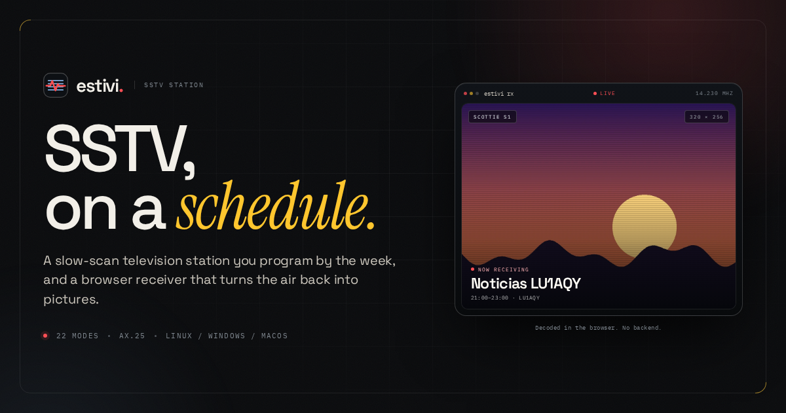

# estivi-webpage

The front door for [Estivi](https://github.com/fluoroom/estivi) — **SSTV, on a schedule.** / **SSTV, con agenda.**



A static landing page for the Estivi project, in English and Spanish. Plain HTML, CSS, and JavaScript; no build step, no framework, no trackers. It is served by nginx from Docker.

## Run it

```sh
docker compose up -d --build
```

Open [http://localhost:8087](http://localhost:8087). The container listens on port 80 internally, publishes port 8087, runs with a read-only root filesystem, and exposes a tiny health endpoint at `/healthz`.

```sh
docker compose logs -f web   # follow the nginx access log
docker compose down          # stop it
```

To preview without Docker:

```sh
python3 -m http.server 8087
```

The two language pages live at `/` and `/es/`.

## What is here

| Path | Purpose |
|---|---|
| `index.html` | The English page. |
| `es/index.html` | The Spanish page. Same structure, translated copy and metadata. |
| `404.html`, `es/404.html` | “Signal lost” / “Señal perdida” pages, wired with `error_page 404` and hidden from search engines. |
| `assets/css/main.css` | The whole design: tokens, layout, components, language switch, responsive rules, reduced-motion fallback. |
| `assets/js/main.js` | The visor decode, mobile menu, demo schedule, mode explorer, gallery and lightbox, copy buttons, reveal and scroll-spy behaviour, plus the English/Spanish dictionaries for dynamic content. |
| `assets/js/lang-detect.js` | The pre-paint language choice: browser-language detection, the saved explicit preference, and the optional 404 redirect opt-out. |
| `assets/fonts/` | Self-hosted Space Grotesk, Instrument Serif, and IBM Plex Mono, plus their OFL licenses. |
| `assets/img/` | Optimized WebP screenshots and demo pictures. No external image requests. |
| `nginx.conf` | The nginx server block: gzip, cache policy, security headers, language-specific 404s, health check. |
| `Dockerfile`, `docker-compose.yml` | Static nginx image and the local service definition. |
| `og-image.png`, `og-image-es.png` | Social preview cards (1200 × 630) for each language. |

The page makes no third-party requests at runtime. Fonts, images, styles, and scripts are all local. There are no cookies and no analytics.

## Languages

- **English** is at `/`, **Spanish** at `/es/`. Both are real, complete pages, not a client-rendered translation.
- A compact **EN / ES** switch lives in the header, in the mobile drawer, and in the footer. It is a pair of normal links, so it works with JavaScript disabled and can be opened in a new tab.
- On a first visit with **no saved choice**, a browser whose primary language starts with `es` is sent from `/` to `/es/`. Visiting `/es/` directly is never redirected away, so shared Spanish links behave.
- Clicking either language link stores an explicit choice in `localStorage` under `estivi-lang`. That choice wins over the browser language in both directions: choosing English on a Spanish machine keeps `/` in English, and choosing Spanish on an English machine keeps `/es/` in Spanish.
- The choice is read before first paint by `assets/js/lang-detect.js`, which is a self-hosted, parser-blocking script. The redirect preserves the query string and anchor.
- `hreflang` alternates and `x-default` are declared on both pages; each page sets `og:locale` and the alternate locale. The two social cards are language-specific.
- All dynamic text (the demo schedule, mode families, gallery captions, ARIA labels, clipboard feedback, and the visor status) is localized from the document language in `main.js`.

To add a new string, update both page documents and the relevant dictionary in `main.js` (`strings`, `weekCopy`, or `galleryCopy`). The Spanish page uses root-relative asset URLs, so it resolves `/assets/...` from `/es/` without extra copies.

## Notes on the page

- The receiver in the hero is a **simulated decode** of the demo channel. It loops; the replay button restarts it. `prefers-reduced-motion` shows the finished picture without the loop.
- The week grid is a **demo channel** using the project’s example programming. Click any block to update the selected-block panel. Programme copy lives in `weekCopy` in `assets/js/main.js`.
- The mode explorer reads the short codes, picture sizes, line counts, and VIS bytes from `modeData`, following the transmitter’s [AX.25 interface](https://github.com/fluoroom/estivi-tx/blob/main/AX25.md). Mode families are localized at render time.
- The gallery tabs and lightbox are keyboard accessible. Arrow keys move between tabs and screenshots; Escape closes the lightbox.
- Links to the transmitter’s [latest release](https://github.com/fluoroom/estivi-tx/releases/latest), the public receiver at [estivi-rx.lu1aqy.radio](https://estivi-rx.lu1aqy.radio), the manual, and the three repositories are absolute external links.

## Editing

- **Links and version references** live in both `index.html` and `es/index.html`. Search for `fluoroom/estivi`, `estivi-rx.lu1aqy.radio`, and `0.2.2`.
- **Colours, type, spacing, and breakpoints** are CSS custom properties at the top of `assets/css/main.css`, with the component rules grouped below them.
- **Static copy** is in the two page documents. Keep the visible text, `aria-label`, and `alt` attributes in sync when changing a passage.
- **Dynamic copy** is in `assets/js/main.js`: `strings`, `weekCopy`, and `galleryCopy` each carry an `en` and an `es` branch. `weekBase` and `galleryBase` hold language-neutral data such as file names and links.
- **Screenshots** are in `assets/img/`. If you replace one, keep its intrinsic `width`/`height` attributes in both page documents accurate so the layout does not shift while loading.
- **Social preview**: the checked-in `og-image.png` and `og-image-es.png` are 1200 × 630. The `og:image` and `twitter:image` metatags currently use root-relative paths because the production domain is decided at deploy time. Set them to absolute URLs (for example `https://example.org/og-image.png` and `https://example.org/og-image-es.png`) once the site has a canonical home, and add `og:url`, canonical links, and absolute `hreflang` URLs at the same time.

## Deployment

The image is just nginx and files:

```sh
docker build -t estivi-webpage .
docker run --rm -p 8087:80 estivi-webpage
```

For production, terminate TLS in front of the container and forward to port 80. The nginx block sets:

- `Content-Security-Policy` — everything from the same origin; inline scripts are not allowed. If you add an embed or third-party script, update the policy.
- `X-Content-Type-Options`, `X-Frame-Options`, `Referrer-Policy`, `Permissions-Policy`.
- Long-lived caching for fonts and images, seven days for CSS and JS, and `no-cache` for HTML in both languages. There is no asset hashing, so bump the paths (or the files themselves) if a change needs to invalidate browser caches.
- gzip for text, JSON, SVG, and JavaScript.
- `error_page 404 /404.html` for English paths and `/es/404.html` for `/es/`; a `GET /healthz` endpoint returns `ok`.
- `/es/` is served as a directory, `/es` redirects to `/es/`, and `assets/` stays shared at the site root.

HSTS is intentionally left to the TLS terminator. The site does not need a database, an application server, or a writable filesystem; the compose service runs with `read_only: true`.

The demo screenshots still show Spanish programme names, the `LU1AQY` station, and the project’s sample artwork. That is deliberate: they come from the real Estivi screenshots and the demo channel.

## Accessibility and performance

- Semantic landmarks, a skip link, visible focus rings, and a focusable skip target.
- The mobile navigation uses `aria-expanded`, closes on Escape or a backdrop click, and returns focus to the toggle.
- The language links carry `lang` and `hreflang`; the current language is marked with `aria-current` and is not a link.
- The lightbox uses a native `<dialog>` with focus restoration and arrow-key navigation.
- Tab lists use the ARIA tabs pattern, including arrow/Home/End keys.
- Animations respect `prefers-reduced-motion`; the hero decode pauses off-screen and while the page is hidden.
- The page also has a small no-JavaScript fallback: the section navigation becomes a static row, and the decorative clock/replay controls are hidden.
- All page imagery is local WebP; below-the-fold gallery images are lazy-loaded. The hero image and the two main fonts are preloaded.

## Credits

The screenshots, demo artwork, and project name come from the Estivi project ([transmitter](https://github.com/fluoroom/estivi-tx), [receiver](https://github.com/fluoroom/estivi-rx)); the sunset and tuning-card images are from the transmitter’s `ejemplo/` directory. Estivi is a project by [LU1AQY](https://lu1aqy.radio).

The three bundled typefaces are licensed under the SIL Open Font License 1.1. Their license files are in `assets/fonts/licenses/`.
